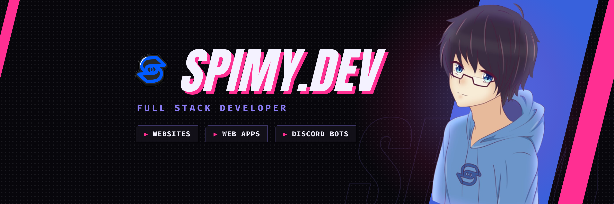

<!-- ═══════════════ ◆ SPIMY.DEV · CHARACTER SCREEN ◆ ═══════════════ -->

<div align="center">
  
</div>

<div align="center">
  <a href="https://spimy.dev">
    
  </a>
</div>

<br />

<!-- ═══════════════ ◆ STATUS ═══════════════ -->

### ◆ STATUS

```yaml
name:      William Law (Spimy)
location:  Mauritius
class:     Full Stack Developer
current:   Software Developer Intern @ Dayforce
degree:    BSc Software Engineering, First Class Honours
main:      TypeScript · Node.js
learning:  C# · ASP.NET Core
loves:     Anime · JRPGs · Genshin Impact · Zenless Zone Zero
```

 

<div align="center"></div>

<!-- ═══════════════ ◆ LOADOUT ═══════════════ -->

<h3 align="center">⚔️ LOADOUT ⚔️</h3>

<div align="center">
  <br />
  <br />
  
</div>

<p align="center"><sub>🔒 Still training: C# · ASP.NET Core · React · Next.js</sub></p>

<div align="center"></div>

<!-- ═══════════════ ◆ STATS ═══════════════ -->

<h3 align="center">📊 STATS 📊</h3>

<div align="center">
  
  
</div>

<div align="center">
  
</div>

<br />

<div align="center">
  
</div>

<div align="center"></div>

<!-- ═══════════════ ◆ INVENTORY ═══════════════ -->

<h3 align="center">📦 INVENTORY 📦</h3>

<div align="center">
  <a href="https://github.com/Spimy/spimy.dev">
    
  </a>
  <a href="https://github.com/Spimy/mapetite">
    
  </a>
  <br />
  <a href="https://github.com/Spimy/recipe-roots-dockerised">
    
  </a>
</div>

<p align="center">✨ The full inventory, with write-ups, lives on <a href="https://spimy.dev/projects"><b>spimy.dev</b></a></p>

<div align="center"></div>

<!-- ═══════════════ ◆ SNAKE ═══════════════ -->

<div align="center">
  
</div>

<!-- ═══════════════ ◆ PARTY CHAT ═══════════════ -->

<h3 align="center">💬 PARTY CHAT 💬</h3>

<p align="center">
  <a href="https://spimy.dev"></a>
  <a href="https://www.linkedin.com/in/william-law-hong-waye/"></a>
  <a href="https://x.com/OfficialSpimy"></a>
  <a href="https://www.youtube.com/@SpimyCodes"></a>
  <a href="https://discord.spimy.dev"></a>
  <a href="https://anilist.co/user/Spimy"></a>
  <a href="mailto:william@spimy.dev"></a>
</p>

<div align="center">
  
</div>